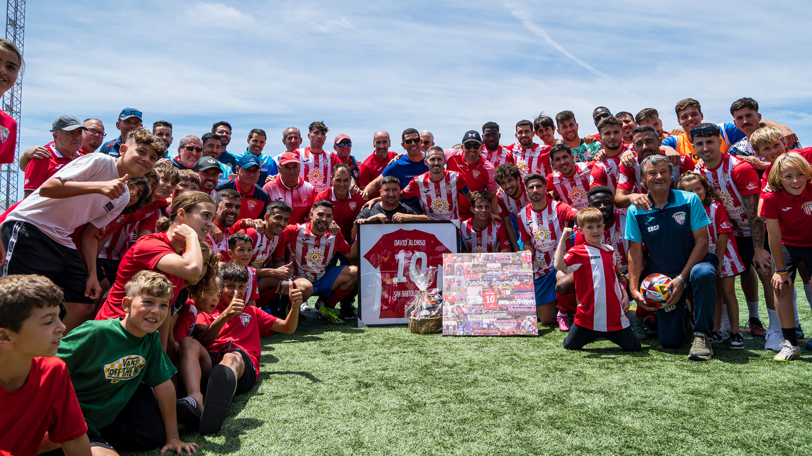

<div align="center">


# San Bartolomé C.F.

### Sitio web informativo y deportivo dedicado al club de Lanzarote

**Proyecto académico personal · Desarrollo desde cero · Sin frameworks ni IA**


[](#estado-del-proyecto)
[](https://fmoorenoo.github.io/San-Bartolome/)
[](https://github.com/fmoorenoo/San-Bartolome)

**[Visitar la web](https://fmoorenoo.github.io/San-Bartolome/)**

</div>

---

## Sobre el proyecto

**San Bartolomé C.F.** es un sitio web informativo inspirado en el club de fútbol de Lanzarote. Se realizó hace unos años como **proyecto final del módulo de Lenguajes de Marcas** del primer curso de **Desarrollo de Aplicaciones Multiplataforma (DAM)**.

Fue una web que desarrollé **íntegramente desde cero**, sin frameworks, sin herramientas de inteligencia artificial y sin reutilizar código de otros proyectos. Todo lo construí con mis **conocimientos básicos de programación de aquella época**, como ejercicio para poner en práctica lo que estaba aprendiendo.

El proyecto reúne información sobre el club, noticias, su trayectoria deportiva y la plantilla. También incorpora una sección de abonos y contenido disponible en **español e inglés**.

> Se trata de un **proyecto académico**, no de un canal oficial de gestión del club. Los contenidos deportivos, datos de contacto y precios incluidos en la web pueden corresponder a la época en que se elaboró el ejercicio.

## Funcionalidades

- **Inicio y noticias:** presentación del club y contenidos informativos.
- **Tercera RFEF:** recorrido por el ascenso y representación de una clasificación deportiva cargada desde un archivo XML.
- **Buscador de jugadores:** consulta de fichas mediante el número de dorsal, utilizando datos de un archivo JSON.
- **Sección de abonos:** información sobre ventajas y demostración de pantallas de selección de forma de pago.
- **Información del club:** apartados de contacto, ubicación y patrocinadores.
- **Contenido bilingüe:** versiones de distintas páginas en español e inglés.
- **Diseño adaptativo:** hojas de estilo orientadas a distintos tamaños de pantalla.

**Nota sobre abonos:** el formulario cambia entre pantallas según el método elegido, pero el código revisado no incluye integración con una pasarela de pago ni procesamiento de transacciones. **No debe utilizarse para realizar pagos reales.**

## Tecnologías

| Área | Tecnologías |
| --- | --- |
| **Estructura** | HTML5 |
| **Diseño** | CSS3 |
| **Interactividad** | JavaScript (vanilla) · DOM |
| **Datos locales** | XML · JSON |
| **Comunicación de archivos** | XMLHttpRequest |
| **Publicación** | GitHub Pages |
| **Herramientas** | Git · GitHub |

Todo el desarrollo se hizo con código propio y sin utilizar frameworks. Es una muestra de mis primeros pasos en desarrollo web y de lo que era capaz de hacer con los conocimientos que tenía entonces.

## Arquitectura

```text
San-Bartolome/
├── index.html               # Inicio y noticias
├── tercera.html             # Trayectoria deportiva y clasificación
├── players.html             # Buscador de futbolistas
├── abonate.html             # Demostración de abonos
├── info.html                # Club, contacto y patrocinadores
├── Z-*.html                 # Páginas de la versión inglesa
├── script.js                # Navegación e interactividad
├── players_catalog.json     # Datos del buscador de jugadores
├── liga.xml                 # Datos de clasificación
├── css/                     # Estilos por sección y estilos generales
└── images/                  # Escudos, jugadores, noticias y recursos
```

La interacción se concentra en `script.js`, mientras que los estilos se organizan en `css/`. La clasificación y los datos de jugadores se consultan a partir de archivos incluidos en el repositorio.

## Vista del proyecto

<div align="center">
  
  <p><sub>Imagen de contenido del sitio web; no es una captura completa del navegador.</sub></p>
</div>

Para explorar las pantallas y el comportamiento real de la interfaz, visita la **[demo publicada](https://fmoorenoo.github.io/San-Bartolome/)**.

## Instalación y ejecución

1. Clona el repositorio:

   ```bash
   git clone https://github.com/fmoorenoo/San-Bartolome.git
   cd San-Bartolome
   ```

2. Inicia un servidor HTTP local en la raíz del proyecto, por ejemplo:

   ```bash
   python -m http.server 8000
   ```

3. Abre `http://localhost:8000/` en el navegador.

Se recomienda utilizar un servidor local en lugar de abrir el HTML directamente con `file://`, ya que las peticiones a `liga.xml` y `players_catalog.json` pueden verse afectadas por restricciones de seguridad del navegador.

**Versión publicada:** [GitHub Pages](https://fmoorenoo.github.io/San-Bartolome/).

## Estado del proyecto

**Proyecto académico de hace unos años, conservado en su versión original.** El repositorio permite ver cómo trabajaba cuando estaba empezando: sin frameworks, sin IA y sin reutilizar código, utilizando los conocimientos básicos que tenía entonces.

Consideraciones importantes:

- **Datos históricos:** noticias, clasificaciones, plantilla, precios y horarios no deben interpretarse como información actualizada del club.
- **Formulario demostrativo:** la selección de formas de pago no equivale a un servicio real de compra de abonos.
- **Datos JSON/XML:** los archivos se almacenan localmente en el repositorio y no se actualizan automáticamente desde fuentes deportivas externas.
- **Accesibilidad y compatibilidad:** no se han realizado pruebas sistemáticas en navegadores o con tecnologías de asistencia durante esta revisión.

## Próximo paso: una nueva versión

Uno de los próximos proyectos que tengo en mente es **volver a desarrollar esta web para el San Bartolomé C.F.**, esta vez desde una perspectiva completamente nueva y aprovechando los conocimientos y la experiencia que he adquirido desde entonces.

Me gustaría crear una versión renovada, con una presentación más cuidada y una experiencia de usuario mejorada. **Por ahora es una idea de futuro**, no una actualización ya realizada ni una nueva web oficial del club.

## Autor

**Fernando Montelongo Moreno** · Full Stack Developer · DAM + DAW

[](https://github.com/fmoorenoo)
[](https://www.linkedin.com/in/fernando-montelongo/)

---

<div align="center">
  <sub>San Bartolomé C.F. · Mi primer desarrollo web desde cero · Próxima renovación en mente</sub>
</div>
